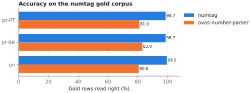

# Benchmarks

<!-- agent-hint
covers: Accuracy of numtag against ovos-number-parser, with the commands that produce them.
source: benchmarks/bench.py, benchmarks/numtag.json, benchmarks/parser.json, tests/gold/, docs/img/plot_benchmarks.py
generated: no
verify: python docs/img/plot_benchmarks.py --check
see: design.md
-->

This page compares numtag with ovos-number-parser on accuracy. Both libraries read the same gold corpus, `tests/gold/`, in their own process. The script is `benchmarks/bench.py`, and every number on this page comes from one run of it per library. The two reports are `benchmarks/numtag.json` and `benchmarks/parser.json`.

## What was measured

| Item | Value |
|---|---|
| numtag | 0.46.0a1 |
| ovos-number-parser | 0.24.62a1 from PyPI, `extract_number_spans(text, lang, ordinals=True)` |
| Corpus | `tests/gold/`: 479 pt-PT rows, 470 pt-BR rows, 444 en rows |
| Python | 3.14.6, the uv interpreter of the laptop |
| Machine | a laptop with an Intel Core i9-11900H |

The parser runs with ordinals on, because that mode finds more of the gold mentions.

## Commands

Each library gets its own virtual environment, so that each run loads one library.

```bash
uv venv .venv
uv pip install --python .venv/bin/python -e .
uv venv .venv-parser
uv pip install --python .venv-parser/bin/python --prerelease=allow "ovos-number-parser==0.24.62a1"
.venv/bin/python benchmarks/bench.py numtag tests/gold benchmarks/numtag.json
.venv-parser/bin/python benchmarks/bench.py parser tests/gold benchmarks/parser.json
python docs/img/plot_benchmarks.py
```

Each run writes a JSON report and prints it. `docs/img/plot_benchmarks.py` reads the two reports, draws the figure and prints the rows of the accuracy table. The parser version is pinned because ovos-number-parser reads numbers with numtag from 0.31.0a1, which requires `numtag>=0.19.0a1`. A run of such a version gives the numtag scores in both columns.

## Accuracy

A row is right when the set of (start, end, value) that the library gives equals the gold set. A gold mention marked `low_confidence` counts when the library reports it at all. A mention is found when the library gives the same span and value.

<picture>
  <source media="(prefers-color-scheme: dark)" srcset="img/benchmarks-dark.svg">
  
</picture>

`img/plot_benchmarks.py` makes this figure from `benchmarks/numtag.json` and `benchmarks/parser.json`.

| Language | Rows | numtag rows right | parser rows right | Gold mentions | numtag found | parser found |
|---|---|---|---|---|---|---|
| pt-PT | 479 | 473 | 388 | 530 | 528 | 414 |
| pt-BR | 470 | 464 | 390 | 513 | 511 | 410 |
| en | 444 | 442 | 358 | 486 | 485 | 400 |

`python docs/img/plot_benchmarks.py --check` compares each row of the table with the two reports. A script writes [languages/index.md](languages/index.md), which gives the numtag gold score of every language. The rows that numtag misses are in [languages/pt.md](languages/pt.md) and [languages/en.md](languages/en.md). The gold values come from sources and hand arithmetic, not from either library.

---
[← Design](design.md) · [Home](index.md) · [Roadmap →](roadmap.md)
