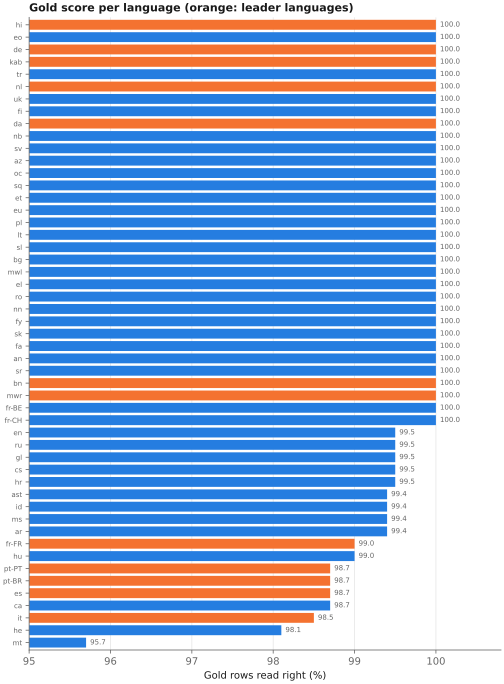

# numtag documentation

<!-- agent-hint
covers: The map of the documentation: what numtag is, a quickstart, and which page answers which question.
source: docs/*.md, numtag/__init__.py:__all__, docs/img/plot_share.py
generated: no
verify: diff <(ls docs/*.md docs/languages/*.md | sed 's#docs/##' | grep -v '^index.md$' | sort) <(grep -o '^| \[[^]]*\]([a-z/-]*\.md)' docs/index.md | sed 's/.*(\(.*\))/\1/' | sort)
see: getting-started.md, api.md
-->

numtag finds every number in a text and gives its exact words, its character span and its exact value.

<picture>
  <source media="(prefers-color-scheme: dark)" srcset="img/share-dark.svg">
  
</picture>

`img/plot_share.py` makes this figure from `benchmarks/results.json`. Each bar is the share of gold rows in `tests/gold/<lang>.jsonl` that numtag reads right.

## Quickstart

```bash
uv pip install --prerelease=allow numtag
```

```python
>>> from numtag import tag_numbers
>>> [(m.text, m.value) for m in tag_numbers("Comprou duas dúzias de ovos por 2,5 euros.", "pt-PT")]
[('duas dúzias', '24'), ('2,5', '2.5')]
```

## Scope

A mention holds the exact words, their character span and an exact value as a digit string. It also holds the kind, the form, a confidence score and, where it matters, the number scale. In some languages numtag also writes the value of a number as words.

numtag reads no units, percentages, ranges, dates or clock times. A caller builds those from the mentions. The chronologia date library reads its numbers with numtag and applies its own date rules.

## Pages

Read the pages in this order.

| Page | What you get there |
|---|---|
| [getting-started.md](getting-started.md) | A walk-through: the first call, then weak mentions, digits in place of words, value conversion, scale and language tags |
| [api.md](api.md) | Every public name: `tag_numbers`, `NumberMention`, `Kind`, `Form`, `Reason`, `Scale`, `Part`, `Role`, `is_canonical_value`, `ARTICLE_CONFIDENCE`, `UnsupportedLanguageError`, `tag_vague_quantities`, `VagueQuantity`, `VagueKind`, `revision` |
| [values.md](values.md) | The three canonical value strings, conversion with `int`, `Decimal` and `Fraction`, and why a value has no length limit |
| [number-scale.md](number-scale.md) | Long and short scale, the `scale` argument and the `number_scale` field |
| [confidence-and-homographs.md](confidence-and-homographs.md) | What a low score means, articles, words with a second meaning, and what a caller does with them |
| [rulings.md](rulings.md) | Each reading rule with an example sentence and its source |
| [languages/index.md](languages/index.md) | The support table: per language, what numtag reads, whether it writes, and its gold score |
| [languages/pt.md](languages/pt.md) | European and Brazilian Portuguese |
| [languages/en.md](languages/en.md) | English |
| [languages/el-ar-he-fa-kab.md](languages/el-ar-he-fa-kab.md) | Greek, Arabic, Hebrew, Persian, Kabyle and Maltese |
| [languages/germanic.md](languages/germanic.md) | German, Dutch, West Frisian, Danish, Swedish, Norwegian Bokmål and Nynorsk |
| [languages/uralic-turkic.md](languages/uralic-turkic.md) | Finnish, Estonian, Hungarian, Turkish and Azerbaijani |
| [languages/baltic.md](languages/baltic.md) | Lithuanian |
| [languages/bn.md](languages/bn.md) | Bengali |
| [languages/hi.md](languages/hi.md) | Hindi |
| [languages/slavic.md](languages/slavic.md) | Russian, Ukrainian, Bulgarian, Polish, Czech, Slovak, Slovene, Croatian and Serbian |
| [languages/fr-it-ro-eu-id.md](languages/fr-it-ro-eu-id.md) | French, Italian, Romanian, Basque, Indonesian and Malay |
| [languages/ibero.md](languages/ibero.md) | Spanish, Galician, Catalan, Asturian, Aragonese, Occitan and Mirandese |
| [adding-a-language.md](adding-a-language.md) | How to add a language: the source rule, gold rows and the test gates |
| [lexicon-format.md](lexicon-format.md) | The lexicon format, versions 1 to 4: every key with its type, default and effect, the schema, and the revision |

## Inside the library

| Guide | Content |
|---|---|
| [design.md](design.md) | Principles, tokenizer, lexicon, grammar, string arithmetic and determinism |
| [benchmarks.md](benchmarks.md) | Accuracy against ovos-number-parser, with the commands |
| [roadmap.md](roadmap.md) | Planned features |

## Terms

A **mention** is one number found in the text. Its **span** is the half-open character range `(start, end)` of its words. Its **value** is a canonical digit string such as `"1200"`, `"2.5"` or `"1/3"`. A **lexicon** is the JSON file that holds the words and settings of one language. A **scale word** is a word such as "mil", "milhão", "thousand" or "billion" that multiplies the count before it.

---
[Getting started →](getting-started.md)
